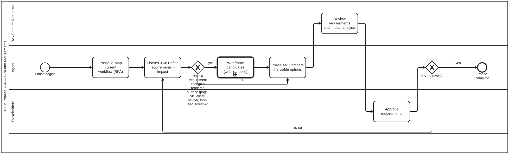

{: .note }
> Generated from `cat-harness/processes/process/crdm-requirements-definition.bpmn` by `gen-processes-viz.ts` — do not edit here. [All processes](index.html)


# CRDM Phases 2–4 — BPA and requirements

`Process_CRDM_Requirements` · strict · 6 step(s)

Map the current workflow, then define the requirements and the impact they carry, and loop until approved. Same shape as Phase 1 and for the same reason: an unapproved requirement is a proposal.

## How it connects

- **Called by:** [CRDM requirements](crdm-requirements.html)
- **Calls:** [Wireframe design review](wireframe-design-review.html)
- **Presented on:** no docs page section shows this diagram

## Lanes — who acts

| lane | role | what it does here |
|---|---|---|
| BA / Feature Requestor | `business-analyst` | The one checkpoint between the agent's comparison and the stakeholders' sign-off: BA_ReviewReqs is where someone who can read the impact analysis on its own technical terms vouches for it, because Lane_Stakeholders reviews only at defined checkpoints and needs the requirement already in a form they can approve without re-deriving it. |
| Agent | `authoring-agent` | Owns Phases 2 through 4a end to end, but the revise loop (GW_Reqs' 'revise' branch) re-enters at A_DefineReqs rather than back at A_MapWorkflow — so mapping the current workflow is this lane's one-time fact-finding, done once per phase run, while defining requirements and comparing options is what gets redone against BA feedback until Lane_Stakeholders approves. When a requirement changes a rendered surface, this lane also designs it before anything is built: GW_RenderedSurface sends it to Call_Wireframe, where the agent is the Designer of Process_WireframeDesignReview and posts its candidates for the BA to choose from. The call sits here rather than in Lane_BA because drawing and checking the candidates is the agent's work; the BA's part is the choice, made at BA_ReviewReqs. |
| Stakeholders | `stakeholder` | The verdict GW_Reqs reads to decide between ending the phase and sending A_DefineReqs around again — a narrower approval than crdm-close.bpmn's final feature sign-off, since what is being approved here is the REQUIREMENT model itself, not that the delivered feature satisfies it. |

## Steps

Every one of the 6 step(s) is documented.

| step | lane | skill / sub-process | what it does |
|---|---|---|---|
| **Phase 2: Map current workflow (BPA)** `A_MapWorkflow` | Agent | [`bpmn-authoring`](../../../reference/skill-instructions/bpmn-authoring.html) | Business-process analysis here means reading the existing diagrams under processes/ and drawing the gap, so the skill that implements this step is the BPMN one. |
| **Phases 3–4: Define requirements + impact** `A_DefineReqs` | Agent | [`crdm-requirements-workflow`](../../../reference/skill-instructions/crdm-requirements-workflow.html) [`data-modelling`](../../../reference/skill-instructions/data-modelling.html) | Two skills, because this step is two things: the requirements come from the CRDM process, the impact half is a question about the entities and relations the change touches, which is what data modelling answers. It named `content-graph` until placement PR3 (bean `63wl`): that is a folio-content skill, and this diagram is the harness's own. |
| **Wireframe candidates (web + mobile)** `Call_Wireframe` | Agent | calls [Wireframe design review](wireframe-design-review.html) [`wireframe-design-review`](../../../reference/skill-instructions/wireframe-design-review.html) | Design use of wireframe-design-review, before implementation: a written design intent, at least two mid-fidelity candidates each with a web and a mobile layout, the mechanical checks, and a blind review. The candidates are committed as assets of the request's proposal, under docs/proposals/<slug>/wireframes/ beside docs/proposals/<slug>.md, on the feature branch so feature-staging publishes them, and shown where the requester will look, chosen from context — the conversation, the issue the request came from, the pull request, or several of these — each place carrying the same staging deep links and screenshots (staging-review, the deep-link rule, point 5: where it goes is a judgement). The requester or BA is the human reviewer and chooses one at BA_ReviewReqs. The owner asked for this on 2026-09-23 (methodologies/wiregen.md): a wireframe is part of the design process for adjudication. The candidates ARE the options A_CompareOptions lays out, so this merges into it rather than producing a second comparison. |
| **Phase 4a: Compare the viable options** `A_CompareOptions` | Agent | [`decision-comparison`](../../../reference/skill-instructions/decision-comparison.html) | Phase 4 often ends with a CHOICE rather than a plan, and this is the step that hands it over. Per option: what it does, its pro, its con, what it changes DOWNSTREAM, and how reversible it is — laid out where the rows can be read against each other, then one recommendation and a stated default. A step of its own rather than a line inside A_DefineReqs, because it has a different output and a different reader: the impact analysis is for the record, the comparison is the thing the BA answers from. Folding it in is how it gets skipped — the analysis feels finished, so the options go over as a list of names. When Call_Wireframe ran, its wireframe candidates are among the options: one row per candidate, with a link to its web and mobile screenshots. Skipped legitimately when the analysis yields ONE viable approach. Do not manufacture alternatives to fill a table. |
| **Review requirements and impact analysis** `BA_ReviewReqs` | BA / Feature Requestor | [`crdm-requirements-workflow`](../../../reference/skill-instructions/crdm-requirements-workflow.html) | The BA reviews the formal requirements and the impact analysis the agent produced. When a requirement changes a rendered surface, the BA (or the requester) also reviews the wireframe candidates, web and mobile, shown wherever the requester will look (the conversation, the issue, the pull request, or several) with staging deep links and screenshots, and chooses one before implementation starts. The agent records the choice; it never makes it. |
| **Approve requirements** `S_ApproveReqs` | Stakeholders | — | Stakeholders approve the requirements and impact analysis on the issue, or send them back for revision. Only their approval moves the work to sign-off; an agent never records an approval on a person's behalf. |

## Decisions

Every one of the 2 decision(s) is documented.

| decision | what decides it | branches |
|---|---|---|
| **Does a requirement change a rendered surface (page, visualiser, navbar, form, app screen)?** `GW_RenderedSurface` | Answered from the requirements A_DefineReqs just wrote: does any of them change what a person sees — a page, a visualiser, the navbar, a form, an app screen? `yes` designs that surface before anything is built; `no` goes straight to comparing options. Asked again on every revise loop, because a revised requirement can add or remove a rendered surface. | **yes** → Wireframe candidates (web + mobile) **no** → Phase 4a: Compare the viable options |
| **BA approves?** `GW_Reqs` | The BA's answer to the requirements and impact. `revise` goes back to defining them; `yes` completes the phase. | **revise** → Phases 3–4: Define requirements + impact **yes** → Phase complete |


