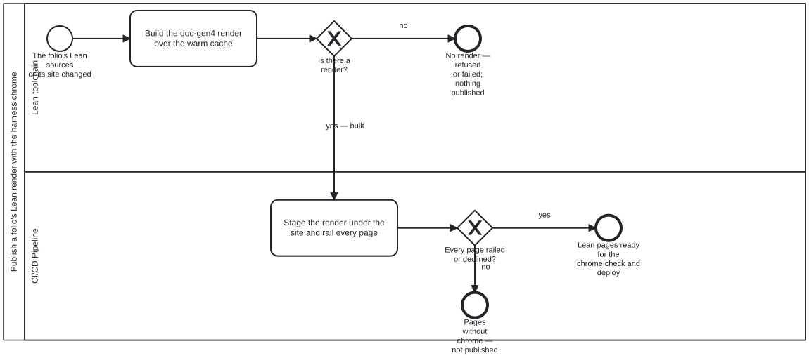

{: .note }
> Generated from `folio-assistant-sci/processes/content/lean-docs-publish.bpmn` by `gen-processes-viz.ts` — do not edit here. [All processes](index.html)


# Publish a folio's Lean render with the harness chrome

`Process_LeanDocsPublish` · strict · 2 step(s)

Build the visualiser of a folio's declared `lean` directory — the Lake package's doc-gen4 HTML render — and put it inside the folio's built site with the harness navbar and rail. Owner, 2026-10-10: "there should be a lean/ visualizer which is then the lean html render (but wrapped w/ cat-harness navbar chrome/rails)".

TWO STEPS IN TWO LANES, BECAUSE THEY FAIL DIFFERENTLY. The build is a Lake run over the folio's warm olean cache: expensive, and able to damage the cache it reads (a Lake build over an untraced restore evicts it). The publish is a file pass over the build's output: seconds, and unable to touch the cache. So the build sits with the Lean toolchain and refuses rather than risks; the publish sits with the build pipeline, in the slot where `stage-folio-local.ts` rails the folio's own pages — after the site is built, before the chrome check and deploy.

BOTH ENDS THAT ARE NOT "READY" PUBLISH NOTHING. A guard that refused, a build that failed, and a page the rail did not reach are all reported as such, never as a site without Lean docs that looks complete.

## How it connects

- **Called by:** no call activity names this process
- **Calls:** none
- **Presented on:** no docs page section shows this diagram

## Lanes — who acts

| lane | role | what it does here |
|---|---|---|
| Lean toolchain | `lean-toolchain` | Owns the Lake run. Hands GW_Built a render directory or a refusal; it never publishes, so nothing it does reaches a reader until Lane_Build has railed and checked it. |
| CI/CD Pipeline | `build-pipeline` | Owns the site. Takes the render from Task_Build, rails it with the platform's own pass, and either hands it on to the folio's chrome check and deploy or stops it at End_Unrailed. |

## Steps

Every one of the 2 step(s) is documented.

| step | lane | skill / sub-process | what it does |
|---|---|---|---|
| **Build the doc-gen4 render over the warm cache** `Task_Build` | Lean toolchain | [`lean-html-docs`](../../../reference/skill-instructions/lean-html-docs.html) | Tool `lean-html-docs` (`adapters/paper/lean/lean-docs-build.sh --lake-root <pkg> --lib <Lib>`). Refuses while another lake/lean process holds `.lake/`, refuses over a restored tree with no traces, checks or restores the warm cache, enables the sentinel-commented doc-gen4 require for this build only, then `lake -R -Kenv=dev build <Lib>:docs`. Output: `<pkg>/.lake/build/doc`. |
| **Stage the render under the site and rail every page** `Task_Publish` | CI/CD Pipeline | [`lean-html-docs`](../../../reference/skill-instructions/lean-html-docs.html) | Tool `lean-render-publish` (`adapters/paper/lean/lean-render.ts --docs <render> --site <site>`). Copies the render to `<site>/lean/` without Lake's bookkeeping, marks doc-gen4's iframe navbar and `find/` redirect rail-declined, adds the layout shim, optionally prunes to the folio's modules, then runs `rail-standalone-pages.ts --foreign-site` over the whole site and checks every staged page. |

## Decisions

Every one of the 2 decision(s) is documented.

| decision | what decides it | branches |
|---|---|---|
| **Is there a render?** `GW_Built` | Answered by Task_Build's exit code: 0 and a render directory, or a refusal (2: a guard; 3: no warm cache) or a failed build (1). Only 0 continues. | **yes — built** → Stage the render under the site and rail every page **no** → No render — refused or failed; nothing published |
| **Every page railed or declined?** `GW_Railed` | Answered by Task_Publish's own closing assertion: a staged page carrying neither the harness rail nor the `folio-navbar: none` opt-out fails it (exit 1). | **yes** → Lean pages ready for the chrome check and deploy **no** → Pages without chrome — not published |


