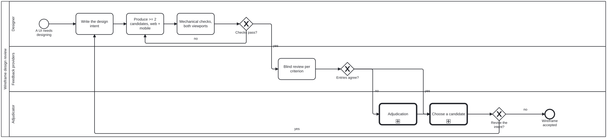

{: .note }
> Generated from [`cat-harness/skills/ui/ui-core/wireframe-design-review.md`](https://github.com/litlfred/folio-assistant/blob/main/cat-harness/skills/ui/ui-core/wireframe-design-review.md) — do not edit here.
>
> [✎ Edit this page's source](https://github.com/litlfred/folio-assistant/edit/main/cat-harness/skills/ui/ui-core/wireframe-design-review.md){: .fa-edit-source data-fa-link="edit" data-src="cat-harness/skills/ui/ui-core/wireframe-design-review.md" data-repo="litlfred/folio-assistant" }


# Wireframe design review

Method: [`wiregen`](https://github.com/litlfred/folio-assistant/blob/main/cat-harness/methodologies/wiregen.md). Process: [`processes/ui/wireframe-design-review.bpmn`](../../en/cat-harness/processes/wireframe-design-review.html). Owner, 2026-09-23: *"need both web and mobile layouts in usability reviews. wireframe is part of design process for adjudication"*.

## Where wireframes live

| use | directory |
|---|---|
| **As-is** | `cat-harness/docs/wireframes/<topic>/` |
| **Design**, from a CRDM request | `docs/proposals/<slug>/wireframes/`, beside the request's proposal `docs/proposals/<slug>.md`: the candidates are **assets of the proposal**. When the proposal is filed (`git mv` to `docs/requirements/`, [`crdm-requirements-workflow`](crdm-requirements-workflow.md)), its asset directory moves with it in the same commit. |

Either directory holds:
- `intent.md`
- one HTML file per candidate
- `authors.json`, which reviewers are not shown
- `checks/`: screenshots and the checker's report
- `reviews/`: one file per reviewer

`cat-harness/docs/wireframes/index.json` maps every declared visualiser ref to the wireframe that covers it. `bun run cat check:wireframes` writes the QA sidecar from it (`test/results/wireframes.qa-results.json`) and fails on any gap.

## Input and output

The contract is [`input.schema.json`](https://github.com/litlfred/folio-assistant/blob/main/cat-harness/schemas/skills/wireframe-design-review/input.schema.json) and [`output.schema.json`](https://github.com/litlfred/folio-assistant/blob/main/cat-harness/schemas/skills/wireframe-design-review/output.schema.json).

- **In:** the `use` (`design` or `as-is`), the `topic` (for CRDM, the proposal slug), the `surface`, and, from CRDM, the `requirements` that change it, the `proposal` path, the `humanReviewer` (requester or BA), the `channels` the candidates are shown in, and the `branch`.
- **Out — the renderings:** `assetDir`, `intent`, and one `candidates[]` entry per candidate: its `source` HTML path, its `screenshots.web` and `screenshots.mobile` paths (from `wireframe-check`), their `staging` deep links, its per-criterion `entries`, and its `outcome` with the `reason`. `chosen` names the candidate, who chose it and the comment that records it; it is absent until a person chooses.
- **Out — as changed assets:** `changedAssets[]` lists every wireframe file the branch adds, changes or removes (candidate HTML, screenshots, intent, reviews) in the record shape a staging preview's graph carries (`change`, `kind`, `title`, `before`, `after`, `source`, `pages` or `pagesUnknown`; `ChangedAsset` in cat-harness-tools `scripts/kg-changed-assets.ts`). The review therefore lists the drawings the same way it lists every other changed asset.
- **Out — staging links:** `stagingLinks`, the shape every request for feedback carries ([`staging-review`](staging-review.md)), copied inline as `$defs.stagingLinks`.

## Two uses

| use | candidates | review |
|---|---|---|
| **Design**: a new or changed UI | at least two, compared blind | per-criterion, then adjudication, then options analysis |
| **As-is**: an existing visualiser, drawn as it renders on `main` | exactly one, marked `as-is` | the same criteria. A finding becomes a bean against the visualiser, not a redesign |

## 1. Intent

A few sentences: **who** the screen is for, **what they need to do**, and **what it must show**. For an as-is wireframe, the intent is read off the visualiser's own declaration and generator, not invented.

## 2. Candidates

- **Mid-fidelity HTML:** monochrome, **real content** from the graph it shows, semantic icons, and no placeholder text.
- **Web and mobile in every candidate**, through responsive CSS or two layouts. A candidate with one layout does not enter review.

## 3. Mechanical checks (Tool `wireframe-check`)

```sh
bun run cat wireframe:check cat-harness/docs/wireframes/<topic>/*.html --out cat-harness/docs/wireframes/<topic>/checks
```

This renders each candidate at web (1280×800) and mobile (390×844) sizes. It records `script` entries for *renders*, *no-overflow* and *no-placeholder*, each `pass` or `fail` with a note, and writes a screenshot per viewport. Any `fail` sends the candidate back to step 2.

## 4. Blind review, per criterion

Reviewers include at least one agent that did not author the candidate and one human. **For Design use called from CRDM, the human is the requester or the BA** who owns the request: the person who will accept the delivered feature chooses its design. They see the intent, the screenshots and the HTML, without the authors. For each criterion they record `pass`, `warn` or `fail`, with a reason:

| criterion | question |
|---|---|
| intent-fit | Does it do what the intent says, for the person it names? |
| web usability | Can the task be done at desktop width? |
| mobile usability | Can the task be done at phone width, by touch? |
| accessibility | Contrast, a non-colour channel, accessible names, keyboard, reading order |
| alternatives | Do the candidates differ in the ways that matter? (Design use only) |

There are no scores and no averages (`methodology-adoption`, Refusals).

## 5. Adjudication and choice

- When entries for one criterion disagree, call **`Process_Adjudication`**. The adjudication leads, the checker's entry is kept, and a dispensation needs its reason.
- The choice between surviving candidates is **`Process_OptionsAnalysis`**. Rejected candidates stay, each with the reason it lost.

## Showing it to the requester

Design use from CRDM ends in a person's choice, so the candidates must be in front of that person before implementation starts:

1. **Commit** the candidates, `intent.md`, `checks/` (screenshots) and `reviews/` under `docs/proposals/<slug>/wireframes/` **on the feature branch**, so `feature-staging` publishes them with the rest of the branch.
2. **Show** them where the requester will look, chosen from context: the conversation, the issue the request came from, the pull request, or more than one of these. Where it goes is a judgement ([`staging-review`](staging-review.md), the deep-link rule, point 5); every place chosen carries the same content: a short narrative of what each candidate does differently; STAGING deep links to each candidate's HTML (not the site root); and its web and mobile screenshots shown as images, not only linked. Say which could not be linked or rendered, and why.
3. **Ask** the requester or BA to choose, with the comparison (one row per candidate, from `A_CompareOptions`) and a recommendation, per [`interaction-modality`](interaction-modality.md) where it applies.
4. **Record** their choice in the proposal and in the output's `chosen`. An agent never chooses on their behalf. Implementation (CRDM Phase 6) builds against the chosen candidate, and the delivery summary links it beside the after-screenshot.

## Related

- [`theme-ui-review`](theme-ui-review.md): reviews the **ingested graphical assets** in their design, also at both viewports. At ingestion only (bean `9fdi`) — it no longer reviews the built result.
- [`adjudication`](adjudication.md)
- [`methodology-adoption`](methodology-adoption.md)


## Processes that run this skill

This skill has its own process: **[Wireframe design review](../../en/cat-harness/processes/wireframe-design-review.html)**.



| process | step(s) that name it |
|---|---|
| [CRDM Phases 2–4 — BPA and requirements](../../en/cat-harness/processes/crdm-requirements-definition.html) | Wireframe candidates (web + mobile) (calls a sub-process) |
| [Wireframe design review](../../en/cat-harness/processes/wireframe-design-review.html) | Write the design intent; Produce >= 2 candidates, web + mobile; Mechanical checks, both viewports; Blind review per criterion |
| [SMART Guideline end to end](../../en/cat-harness/processes/smart-guideline-end-to-end.html) | 4 · Create / adapt L2 DAK assets; Review each L2 asset (before / after if adapted) (calls a sub-process); Review each L3 asset (before / after if adapted) (calls a sub-process); 8a · Wireframe the application; Adjudicate the wireframes and the application (calls a sub-process) |

