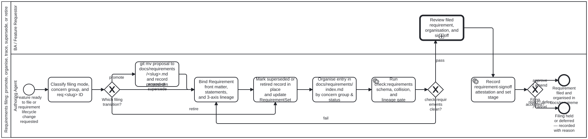

# Requirements filing and organisation — literature search, candidate methodologies, and filing process

This methodology node completes bean `folio-assistant-qh1s` (Issue [#1164](https://github.com/litlfred/folio-assistant/issues/1164)): a literature search over requirements-management practice across the five lifecycle dimensions (**organisation**, **identifiers**, **traceability**, **change**, and **retirement**), the explicit adoption or rejection of candidate methodologies through [`methodology-adoption`](../skills/process/process-core/methodology-adoption.md), and the proposed executable BPMN filing process ([`processes/sdlc/requirements-filing.bpmn`](../processes/sdlc/requirements-filing.bpmn)) put to the owner before automation is built.

Whereas sibling methodology [`requirements-standards-assessment.md`](requirements-standards-assessment.md) (bean `folio-assistant-1gf7`) assessed open interchange and syntax standards (ReqIF, OSLC RM, EARS, RFC 2119 / RFC 8174, IEEE 29148, Planguage, SysML, Gherkin) to map their constructs onto [`bootstrap/schemas/requirement.schema.json`](../../bootstrap/schemas/requirement.schema.json) and [`bootstrap/schemas/requirement-set.schema.json`](../../bootstrap/schemas/requirement-set.schema.json), this node governs **how requirements are organised, identified, traced, amended, superseded, and retired as they are filed** into [`docs/requirements/`](../docs/requirements/index.md) once `docs/requirements/` grows past a flat hand-maintained list.

---

## 1. Literature search over requirements-management practice

Per [`literature-search`](../skills/library/library-core/literature-search.md), every surveyed source is recorded below with its provenance/access status (ingested `library/<bib-slug>` node where held on disk, or external standard / open-source specification where copyright or scope keeps the full text outside `library/`) and with **what it offers here** across the five dimensions of bean `folio-assistant-qh1s`:

1. **Organisation** — how a growing corpus of filed requirements is structured and navigated without breaking path stability.
2. **Identifiers** — how requirements and sub-clauses receive durable, collision-free, human- and machine-addressable IDs in a distributed Git workflow.
3. **Traceability** — how backward lineage (to proposals, user needs, and L1 sources), horizontal dependencies (between requirements), and forward verification (to beans, skills, processes, and test attestations) are recorded and checked.
4. **Change** — how in-scope amendments versus scope-altering replacements are distinguished, reviewed, and versioned.
5. **Retirement** — how obsolete or superseded requirements leave active force without breaking historical links or audit trails.

### 1.1 Summary matrix across the five filing dimensions

| Source | Provenance / library status | Organisation | Identifiers | Traceability | Change | Retirement |
|---|---|---|---|---|---|---|
| **ISO/IEC/IEEE 29148:2018** (*Systems and software engineering — Life cycle processes — Requirements engineering*, Clauses 5.2.7, 6.4, 6.5) | Proprietary ISO/IEEE standard; assessed via public clause structure (no full-text redistributable PDF in `library/`) | Separates stakeholder requirements (StRS) from system/software requirements (SyRS/SRS); organises by system architecture or functional domain | Unique, persistent requirement identifier (`id`) independent of document section position | Clause 5.2.7 mandates **bidirectional traceability**: backward to source/parent need, forward to design elements and verification records | Clause 6.5 requires formal change control, impact analysis over dependent items, and baseline sign-off | Explicit lifecycle status attribute (`retired` / `obsolete` / `superseded`); historical records retained for audit |
| **Volere Requirements Specification Template** (Robertson & Robertson, *Mastering the Requirements Process*, 4th ed.) | Commercial book / template; assessed via published Volere atomic "Snow Card" specification | Groups requirements by **functional area / business event / concern** rather than implementation module; pairs functional with non-functional categories | Atomic requirement number + type code + event/use-case reference on each Snow Card | Each card records **Source / Originator**, **Supporting Materials**, **Dependencies**, and a mandatory measurable **Fit Criterion** | **History** log on the card tracking creation, amendments, and re-verification | Explicit **archived / retired** state with reason when business rules change; card number is never reused |
| **IREB CPRE Foundation Level** (Pohl & Rupp, *Requirements Engineering Fundamentals*, 3rd ed.) | Standard RE body of knowledge; external textbook | Contrasts tree-structured chapter hierarchies against **faceted / attribute-driven views** over atomic requirement objects | Recommends immutable object identifiers decoupled from chapter headings so restructuring views never renumbers requirements | Defines three explicit trace link directions: **pre-RS / backward** (to origins), **post-RS / forward** (to artefacts/tests), and **within-RS / horizontal** (`dependsOn`, `refines`, `conflictsWith`) | Configuration management and baseline versioning; change impact propagation along trace links | Status state machine (`draft → agreed → validated → implemented → deprecated/retired`) |
| **Doorstop** (Browning & Adams, *Doorstop: Text-Based Requirements Management Using Version Control*, JOSS 2014; `github.com/doorstop-dev/doorstop`) | Open-source Git-native requirements tool (`lgpl-3.0`); external software reference | Stores **one text file per requirement** (YAML or Markdown-with-front-matter) inside version-controlled directories representing document trees | Prefix + identifier per file, addressable in git diffs; supports sub-links and hierarchical parent pointers | Parent/child trace links stored directly in requirement front matter; detects **suspect links** when a parent requirement changes | Git commits and pull requests *are* the change-control log; review happens in PR diffs alongside code and tests | `active: false` / `normative: false` front-matter flags retire an item in place without `git rm`, keeping git blame and incoming links intact |
| **Nygard ADRs & MADR 3.0.0** (Nygard 2011; Kopp et al., `adr.github.io/madr/`, already adopted in [`methodologies/madr.md`](madr.md)) | Adopted harness methodology ([`methodologies/madr.md`](madr.md)) | Flat directory of Markdown files (`docs/decisions/` or `docs/proposals/`), indexed by concern or status in `index.md` | Filename slug (`<slug>.md`) serves as the stable human-readable identifier | Cross-references related decisions, issues, and motivating forces in front matter and body | **Append-only / immutable intent**: minor clarifications edit in place; substantive reversals file a new record that supersedes the old | Explicit status transitions: `proposed → accepted → deprecated | superseded by ADR-XXXX`; old files are **never deleted** |
| **W3C PROV-O** (*PROV-O: The PROV Ontology*, W3C Recommendation 2013, adopted in [`methodologies/prov-o-provenance.md`](prov-o-provenance.md)) | Ingested in [`library/w3c-2013-prov-o`](../library/kg/w3c-2013-prov-o/README.md) | Graph of `prov:Entity` nodes linked by typed provenance relations independent of filesystem nesting | Stable IRIs (`req:<slug>`, `req:<slug>#<key>`) identifying each entity | `prov:wasDerivedFrom` (parent/source lineage), `prov:wasGeneratedBy` (filing/test activity), `prov:wasAttributedTo` (actor/sign-off) | `prov:wasRevisionOf` and `prov:specializationOf` distinguish revisions from distinct derived entities | `prov:wasInvalidatedBy` and `prov:invalidatedAtTime` model retirement/supersession without erasing the entity from the provenance graph |
| **RFC 2119 & RFC 8174** (Bradner 1997; Leiba 2017 — BCP 14 key words) | Ingested in [`library/rfc2119-key-words-requirement-levels`](../library/content/rfc2119-key-words-requirement-levels/README.md) and [`library/rfc8174-uppercase-vs-lowercase-2119-key-words`](../library/content/rfc8174-uppercase-vs-lowercase-2119-key-words/README.md) | Separates normative statements (`MUST`, `SHOULD`, `MAY`) from explanatory prose within a specification | Statement-level addressing (`statements[].key` → `req:<slug>#<key>`) so each normative keyword clause is individually citable | Pairs each uppercase keyword statement with its own `successCriteria` and verification witness | Changing a statement's modality (`SHOULD` → `MUST`) is a normative change requiring re-sign-off | Retiring or relaxing a `MUST` statement requires explicit normative adjudication |
| **Specification-Compiled Agents & Issue-Driven Work Plans** (`arxiv-2404.04834v4`; `hmans-2026-beans-readme`) | Ingested in [`library/arxiv-2404.04834v4`](../library/sdlc/arxiv-2404.04834v4/README.md) and [`library/hmans-2026-beans-readme`](../library/sdlc/hmans-2026-beans-readme/README.md) | Connects declarative specifications to executable agent work items (`beans/`) and automated verification gates | Cross-graph IDs: `req:<slug>` linked to bean IDs (`folio-assistant-xxxx`) and process IDs (`Process_*`) | Closed-loop compilation: requirement statement → work-plan bean → implementing skill/process → test attestation | Specification edits trigger deterministic re-check (`check:requirements`) across all linked sets and attestations | Completed beans archive when closed; filed requirements remain `in-force` as the persistent invariant until superseded or retired |
| **IEEE Std 830-1998** (*IEEE Recommended Practice for Software Requirements Specifications*, superseded by ISO/IEC/IEEE 29148) | Historical IEEE standard (superseded); external baseline | Monolithic single-document SRS organised by deep numbered outline (`3.1.1.1 Functional Requirement 1`) | Positional section numbers (`§3.2.4.1`) tied to document outline location | External traceability matrices (spreadsheets) mapping section numbers to test cases | Document-level revision history table at the top of the monolithic SRS | Striking out or deleting sections in a new SRS edition, causing section renumbering unless placeholder sections are kept |

### 1.2 Detailed source notes: what each source offers this harness

#### 1.2.1 ISO/IEC/IEEE 29148:2018 (Clauses 5.2.7, 6.4, and 6.5)
- **What it offers here**:
  - **Attribute canon (Clause 6.5)**: Defines the essential metadata attributes every managed requirement needs beyond its statement text: unique identifier, requirement status, source/origin, rationale, priority/modality, verification method/criteria, and trace links. Our [`bootstrap/schemas/requirement.schema.json`](../../bootstrap/schemas/requirement.schema.json) directly embodies this attribute set (`id`, `title`, `status`, `proposedIn`, `derivedFrom`, `dependsOn`, `statements[]`, `beans`, `skills`, `processes`, `supersededBy`).
  - **Bidirectional traceability (Clause 5.2.7)**: Establishes that forward traceability alone (requirement → test) is half a system; backward traceability (requirement → originating proposal/need/source via `proposedIn` and `derivedFrom`) is what prevents gold-plating (orphan requirements with no stakeholder origin) and explains *why* a constraint exists when an agent later considers changing it.
  - **Change and retirement discipline**: Distinguishes an approved baseline from working drafts (`RequirementSet.stage`: `draft → proposed → approved → accepted` in [`bootstrap/schemas/requirement-set.schema.json`](../../bootstrap/schemas/requirement-set.schema.json)) and requires any transition into or out of active force to carry human sign-off.

#### 1.2.2 Volere Requirements Specification Template (Robertson & Robertson)
- **What it offers here**:
  - **Atomic "Snow Card" structure with Fit Criteria**: Volere's primary contribution is insisting that a requirement is not filed until its **Fit Criterion** (our `statements[].successCriteria`) is written beside the description (`statements[].statement`). A requirement whose fit criterion cannot be stated is still a proposal or open question.
  - **Organisation by semantic concern / business domain**: Rather than organising requirements by the code file they touch or chronological filing date, Volere organises requirements by functional domain / concern area so a reader auditing one domain sees all governing invariants together. In `cat-harness`, the eight canonical concern groups in [`code-lists/concern-group.json`](../code-lists/concern-group.json) (`sdlc`, `process`, `tools`, `kg`, `library`, `content`, `ui`, `conduct`) already partition skills, processes, schemas, and tests; projecting filed requirements under those same eight concern groups in [`docs/requirements/index.md`](../docs/requirements/index.md) aligns requirement navigation with the rest of the knowledge graph.

#### 1.2.3 IREB CPRE (Pohl & Rupp, *Requirements Engineering Fundamentals*)
- **What it offers here**:
  - **Decoupling identification and storage from presentation views**: IREB highlights the classic failure mode of hierarchical specifications: when chapter structure is used as both the file path and the requirement ID, reorganising chapters breaks every incoming reference. Storing atomic requirements at stable paths with immutable IDs (`docs/requirements/<slug>.md` → `req:<slug>`) while providing **faceted views** (grouped by concern group, by `RequirementSet`, or by lifecycle `status` in `docs/requirements/index.md`) gives both stable URIs and structured human browsing.
  - **Three-axis trace topology**: Clarifies the distinction between **backward trace** (`proposedIn`, `derivedFrom`), **horizontal trace** (`dependsOn` between peer requirements), and **forward trace** (`beans`, `skills`, `processes`, and verification attestations).

#### 1.2.4 Doorstop (Browning & Adams, JOSS 2014)
- **What it offers here**:
  - **Git-native file-per-requirement architecture**: Doorstop proved that storing requirements as individual text files with YAML front matter and Markdown prose in the same Git repository as the implementation eliminates external ALM database drift. Every requirement filing, amendment, or retirement travels in the same pull request as the code, process diagram, and test attestation that implements or verifies it.
  - **In-place retirement (`status: retired` / `superseded`)**: Doorstop retires requirements by flipping a front-matter status field rather than deleting the file (`git rm`), ensuring that historical commits, test runs, and child requirements never point to a missing file.
  - **Suspect-link awareness**: Doorstop flags downstream items when an upstream requirement changes. In our harness, `check:requirements` (`scripts/check-requirements.ts`) provides the deterministic equivalent: it verifies that every `derivedFrom`, `dependsOn`, and `supersededBy` target exists, that no cycle exists in `derivedFrom`, that no `in-force` requirement depends on a `retired` or `superseded` requirement without updating its own lineage, and that every `RequirementSet` at `approved` or `accepted` has a matching human `requirement-signoff` attestation and only `in-force` members.

#### 1.2.5 Nygard ADRs & MADR 3.0.0 ([`methodologies/madr.md`](madr.md))
- **What it offers here**:
  - **Proposal-to-Requirement continuity (`git mv` + `proposedIn`)**: In `cat-harness`, a feature starts as a proposal in `docs/proposals/<slug>.md` (where options are weighed using Kepner-Tregoe, SWOT, and MADR). When the feature ships and is signed off, `git mv docs/proposals/<slug>.md docs/requirements/<slug>.md` promotes the file in place, preserving its slug, its `git log --follow` history, and the options analysis that justified it, while `proposedIn` records the commit SHA and path of the proposal before the move.
  - **Immutable supersession chain**: When a shipped requirement's fundamental contract is replaced by a new design, the old requirement file is not overwritten into a different contract; instead, the new proposal is filed as `docs/requirements/<new-slug>.md`, and the old requirement's front matter is updated to `status: superseded` with `supersededBy: req:<new-slug>`.

---

## 2. Candidate methodologies: adopted vs rejected with reasons

Following [`skills/process/process-core/methodology-adoption.md`](../skills/process/process-core/methodology-adoption.md), we do not invent an unattributed house method. We adopt four orthogonal practices from the surveyed literature—naming their origins, what is taken, what is left behind, and how each binds into `bootstrap/schemas/requirement.schema.json` and `check:requirements`—and we explicitly reject five candidate practices with documented reasons.

### 2.1 Adopted methodologies

#### M1 — Doorstop + MADR git-native file-per-requirement and two-level semantic identifiers (`req:<slug>` and `req:<slug>#<key>`)
- **Origin**: Doorstop (Browning & Adams 2014) for one-file-per-requirement in Git with YAML front matter + Markdown body; MADR ([`methodologies/madr.md`](madr.md)) for human-readable `<slug>.md` filenames; RFC 2119 / RFC 8174 ([`methodologies/requirements-standards-assessment.md`](requirements-standards-assessment.md)) for statement-level normative clauses.
- **What is adopted**:
  1. Each filed requirement lives in its own Markdown file at `docs/requirements/<slug>.md` with `id: req:<slug>` matching its filename stem (`^req:[a-z0-9][a-z0-9-]*$`).
  2. Individual normative clauses inside a requirement are declared in `statements[]` (`key`, `modality`, `statement`, `successCriteria`) and addressed as `req:<slug>#<key>` (`^req:[a-z0-9][a-z0-9-]*#[a-z0-9][a-z0-9-]*$`).
  3. Across `docs/proposals/` and `docs/requirements/`, every `<slug>` is globally unique: a slug exists either as an unshipped proposal in `docs/proposals/<slug>.md` or as a filed requirement in `docs/requirements/<slug>.md`, never both (`check:requirements` refuses a collision).
- **What is left behind and why**:
  - Doorstop's auto-incremented numeric filenames (`REQ001.yml`, `REQ002.yml`) are left behind because concurrent feature branches in a multi-agent repository collide on sequential integers and opaque numbers hide meaning in prose and test logs.
  - Doorstop's content-hash "fingerprint" clearing on whitespace edits is left behind because explicit lifecycle `status` + human `requirement-signoff` attestations (`test/attestations/requirement-signoff/`) provide stronger, semantically intentional governance than raw byte hashes.

#### M2 — Faceted concern-group organisation (`code-lists/concern-group.json`) over flat `docs/requirements/<slug>.md` storage (Volere + IREB faceted view)
- **Origin**: Volere functional-area grouping (Robertson & Robertson) combined with IREB CPRE's separation of stable storage identifiers from faceted navigation views (Pohl & Rupp), bound to the harness's eight canonical concern groups in [`code-lists/concern-group.json`](../code-lists/concern-group.json).
- **What is adopted**:
  1. **Physical storage stays flat at `docs/requirements/<slug>.md`**: Every filed requirement sits directly in `docs/requirements/<slug>.md`, preserving 1:1 path parity with `docs/proposals/<slug>.md` for `git mv`, keeping `req:<slug>` → `docs/requirements/<slug>.md` resolution O(1) without directory searches, and ensuring `check:requirements` (`mdFilesIn`) reads 100% of filed requirements.
  2. **Logical organisation in `docs/requirements/index.md` groups by two orthogonal views**:
     - **By Concern Group** (`sdlc`, `process`, `tools`, `kg`, `library`, `content`, `ui`, `conduct` from [`code-lists/concern-group.json`](../code-lists/concern-group.json)), so a reader or agent working in a concern domain sees every `in-force` invariant governing that domain.
     - **By Requirement Set (`RequirementSet`) and Lifecycle Status** (`in-force` vs `superseded` / `retired`), so CRD baselines and historical records are cleanly separated from active invariants.
- **What is left behind and why**:
  - Physical subdirectory nesting (`docs/requirements/<group>/<slug>.md`) is rejected (see R3 below) so that reclassifying a requirement's concern group or cross-cutting scope never breaks markdown links or requires a second `git mv`.

#### M3 — ISO/IEC/IEEE 29148 + IREB + W3C PROV-O three-axis bidirectional traceability
- **Origin**: ISO/IEC/IEEE 29148:2018 Clause 5.2.7 (bidirectional traceability), IREB CPRE (backward / horizontal / forward trace links), and W3C PROV-O (`library/w3c-2013-prov-o`, [`methodologies/prov-o-provenance.md`](prov-o-provenance.md)).
- **What is adopted**:
  1. **Backward traceability (to origin and parent sources)**:
     - `proposedIn`: required on every requirement promoted from `docs/proposals/<slug>.md` (`commit` SHA + `path: docs/proposals/<slug>.md`), binding `prov:wasDerivedFrom` to the exact pre-move proposal revision.
     - `derivedFrom`: array of parent `req:<slug>` IDs or `library/<bib-slug>` L1 sources from which this requirement is derived (checked for existence and acyclicity by `check:requirements`).
  2. **Horizontal traceability (between peer requirements)**:
     - `dependsOn`: array of `req:<slug>` IDs that this requirement relies on at runtime or design time (checked for existence by `check:requirements`).
  3. **Forward traceability (to work items, implementation, and verification)**:
     - `beans`: work-plan bean IDs (`folio-assistant-xxxx`) that delivered or amended the requirement.
     - `skills` and `processes`: the `Skill` and `Process` (`Process_*`) nodes that implement the requirement.
     - Verification & Sign-off: test runs (`test/runs/`) and attestations (`test/attestations/`) citing `req:<slug>` or `req:<slug>#<key>`, plus `RequirementSet` membership and human sign-off attestations in `test/attestations/requirement-signoff/<set-slug>.attestations.json`.

#### M4 — MADR / ISO 29148 immutable lifecycle for change, supersession, and retirement (`proposed → in-force → superseded | retired`)
- **Origin**: MADR 3.0.0 ([`methodologies/madr.md`](madr.md)) and ISO/IEC/IEEE 29148 Clause 6.5 configuration & change control.
- **What is adopted**:
  1. **Four lifecycle states (`status` in `requirement.schema.json`)**:
     - `proposed`: drafted in `docs/requirements/<slug>.md` (or in a `RequirementSet` at `draft` / `proposed` / `approved` stage) awaiting final delivery and acceptance sign-off.
     - `in-force`: shipped, verified, and accepted by human BA/owner sign-off; actively binds the codebase and knowledge graph.
     - `superseded`: replaced by a newer requirement; **must** carry `supersededBy: req:<new-slug>` (enforced by `requirement.schema.json` `allOf` rule and `check:requirements`).
     - `retired`: no longer applicable (the feature or constraint was intentionally removed without replacement); `supersededBy` is omitted, and the retirement rationale and authorising issue/bean are recorded in the document body.
  2. **Change decision rule (Amendment in place vs Supersession)**:
     - **In-scope amendment (edit in place, keep `req:<slug>`)**: When clarifying prose, adding a `statements[]` sub-clause, tightening a `successCriteria` check, or updating `skills`/`processes`/`beans` links without reversing the core invariant, edit `docs/requirements/<slug>.md` in place and record a fresh `requirement-signoff` attestation if its `RequirementSet` is `approved` or `accepted`.
     - **Scope-reversing replacement (file `req:<new-slug>`, mark old `superseded`)**: When a new proposal reverses or fundamentally replaces an `in-force` requirement's contract, file the new proposal at `docs/requirements/<new-slug>.md` (`status: in-force`, `derivedFrom: [req:<old-slug>]`), and update `docs/requirements/<old-slug>.md` to `status: superseded` with `supersededBy: req:<new-slug>`.
  3. **Set membership consistency**: Because `check:requirements` enforces that an `approved` or `accepted` `RequirementSet` may only contain `in-force` (or `proposed` at `approved` stage) members, superseding or retiring a requirement requires updating any `RequirementSet` that lists it (replacing the old ID with `req:<new-slug>` or removing the retired ID under a re-signed set amendment).

### 2.2 Rejected candidate methodologies (with reasons)

| Candidate methodology | Verdict | Reason for rejection in this harness |
|---|---|---|
| **R1 — IEEE Std 830-1998 monolithic SRS & positional section numbering (`§3.2.1.4`)** | **Rejected** | Tying a requirement's identifier to its outline position in a single monolithic file causes cascading renumbering whenever a section is inserted, split, or reordered. Renumbering breaks `req:` URIs in test runs, attestations, and beans, and a single monolithic SRS file creates constant Git merge conflicts across parallel agent branches. |
| **R2 — Centralised sequential integer IDs (`REQ-0001`, `FR-0042`)** | **Rejected** | In a distributed multi-agent Git workflow (worktrees, branches, subagents), two branches filing requirements concurrently will allocate the same next integer (`REQ-0043`) unless gated by an external lock server. Even when unique, opaque integers convey no domain meaning in test logs or prose compared to `req:<slug>#<key>`. (Note: `FR-NNN` may still appear as a local table label inside a single CRD proposal during discussion, but the canonical graph identifier is `req:<slug>#<key>`.) |
| **R3 — Physical subdirectory sharding (`docs/requirements/<group>/<slug>.md`)** | **Rejected** (kept as faceted index view in `docs/requirements/index.md` instead) | 1. `check:requirements` (`scripts/check-requirements.ts`, `mdFilesIn`) scans `docs/requirements/` and `docs/proposals/` non-recursively and enforces a 1:1 slug namespace between `docs/proposals/<slug>.md` and `docs/requirements/<slug>.md`. 2. Many proposals span multiple concern groups (e.g., `sdlc` + `process`); forcing a single directory path would make paths brittle when concern boundaries evolve. 3. Faceted grouping in `docs/requirements/index.md` delivers the navigational benefit of Volere/concern-group organisation with zero path churn. |
| **R4 — ReqIF XML / OSLC RM RDF triples as the primary authored store** | **Rejected** (consistent with [`requirements-standards-assessment.md`](requirements-standards-assessment.md)) | XML UUID graphs and raw RDF triples are unreadable in GitHub PR reviews and cannot be naturally co-authored as prose + front matter by humans and agents. Our YAML front matter (`bootstrap/schemas/requirement.schema.json`) exports cleanly to JSON-LD (`bootstrap/ns.jsonld`) without burdening authors with XML. |
| **R5 — Destructive deletion (`git rm`) of superseded or retired requirements** | **Rejected** | Deleting `docs/requirements/<slug>.md` when a requirement is retired or superseded breaks historical provenance: past `test/runs/`, `test/attestations/`, `beans/`, and `derivedFrom` links would become dangling references. Keeping the file in `docs/requirements/<slug>.md` with `status: superseded` (`supersededBy: req:<new-slug>`) or `status: retired` preserves referential integrity across the graph. |

---

## 3. Proposed filing process (`processes/sdlc/requirements-filing.bpmn`)

To fulfil Criterion 3 of bean `folio-assistant-qh1s` (*"a filing PROCESS proposed as BPMN, to be put to the owner before it is built"*), the executable BPMN diagram [`processes/sdlc/requirements-filing.bpmn`](../processes/sdlc/requirements-filing.bpmn) (`Process_RequirementsFiling`) models the end-to-end process for filing, organising,superseding, or retiring a requirement in `docs/requirements/`.

### 3.1 Where `Process_RequirementsFiling` sits in the lifecycle

In the CRDM lifecycle ([`skills/sdlc/crdm/crdm-requirements-workflow.md`](../skills/sdlc/crdm/crdm-requirements-workflow.md)):
1. Phases 1–4 (`crdm-needs.bpmn`, `crdm-requirements-definition.bpmn`, `crdm-data-model.bpmn`, `crdm-signoff.bpmn`) produce and sign off a proposal in `docs/proposals/<slug>.md` (and optionally a `RequirementSet` moving from `draft` → `proposed` → `approved`).
2. Phase 5 (`crdm-deliver.bpmn`) builds and verifies the MVP in code, skills, and processes.
3. **At Phase 6 (`crdm-close.bpmn`), when the feature ships and stakeholders/BA confirm acceptance criteria are met**, `Process_RequirementsFiling` (`processes/sdlc/requirements-filing.bpmn`) governs the transition of the proposal into `docs/requirements/<slug>.md` (or the amendment, supersession, or retirement of an existing filed requirement).

### 3.2 Lanes and responsibilities

| Lane | Role (`partitionElementRef`) | Responsibility in `Process_RequirementsFiling` |
|---|---|---|
| **BA / Feature Requestor** (`Lane_BA`) | `business-analyst` | Reviews the filed requirement's organisation, traceability links, normative statements, and any supersession/retirement transition (`BA_ReviewFiling`), and issues the human sign-off decision (`approve`, `amend`, `reject`, `defer`, `cancel`) required by `check:requirements` before a `RequirementSet` can reach `accepted`. |
| **Authoring Agent** (`Lane_Agent`) | `authoring-agent` | Executes the deterministic filing steps: classifies the requirement's concern group and filing mode (`A_ClassifyFiling`), moves or updates the file in `docs/requirements/<slug>.md` (`A_PromoteOrUpdate`), binds the `Requirement` front matter (`A_BindFrontMatter`), updates superseded/retired records (`A_UpdateLifecycle`), indexes the requirement in `docs/requirements/index.md` (`A_UpdateIndex`), runs `check:requirements` (`A_RunCheck`), and records the human sign-off attestation (`A_RecordFilingSignoff`). |

### 3.3 Step-by-step walkthrough of `processes/sdlc/requirements-filing.bpmn`

1. **`A_ClassifyFiling` — Classify filing mode, concern group, and `req:<slug>` identifier** (`skill: crdm-requirements-workflow`):
   - Determine which of the three filing modes applies:
     - **New filing from proposal**: promoting `docs/proposals/<slug>.md` → `docs/requirements/<slug>.md`.
     - **In-place amendment or supersession**: amending an existing `docs/requirements/<slug>.md` or superseding `req:<old-slug>` with `req:<new-slug>`.
     - **Retirement**: retiring an obsolete `docs/requirements/<slug>.md` (`status: retired`).
   - Assign the primary concern group from [`code-lists/concern-group.json`](../code-lists/concern-group.json) (`sdlc`, `process`, `tools`, `kg`, `library`, `content`, `ui`, `conduct`) for indexing in `docs/requirements/index.md`.
2. **`GW_FilingMode` — Which filing transition?** (`cat-harness.processes:judgement`):
   - Branches on the three modes: `promote` (from `docs/proposals/<slug>.md`), `amend-or-supersede` (on an existing requirement), or `retire` (marking an active requirement `retired`).
3. **`A_PromoteOrUpdate` — `git mv` proposal to `docs/requirements/<slug>.md` and capture `proposedIn`** (`skill: crdm-requirements-workflow`):
   - On the `promote` branch, record the pre-move commit SHA (`git log -1 --format=%H -- docs/proposals/<slug>.md`), execute `git mv docs/proposals/<slug>.md docs/requirements/<slug>.md` so Git history stays unbroken, and populate `proposedIn: { commit, path: "docs/proposals/<slug>.md" }`.
4. **`A_BindFrontMatter` — Bind `Requirement` front matter, statements, and 3-axis lineage** (`skill: specification-management`):
   - Validate or author the YAML front matter against [`bootstrap/schemas/requirement.schema.json`](../../bootstrap/schemas/requirement.schema.json):
     - `id: req:<slug>`, `title`, `status: in-force` (or `proposed` prior to acceptance sign-off);
     - `statements[]` with stable `#<key>`, RFC 2119 `modality` (`MUST` / `SHOULD` / `MAY`), normative `statement`, and measurable `successCriteria`;
     - Backward lineage (`proposedIn`, `derivedFrom`), horizontal dependencies (`dependsOn`), and forward implementation links (`beans`, `skills`, `processes`).
5. **`A_UpdateLifecycle` — Update superseded or retired requirement records and `RequirementSet` membership** (`skill: specification-management`):
   - When superseding `req:<old-slug>` or retiring a requirement, set `status: superseded` + `supersededBy: req:<new-slug>` (or `status: retired` with retirement rationale in prose) on the old file without deleting it, and update any `RequirementSet` in `docs/requirements/*.set.json` so no `approved`/`accepted` set retains a non-`in-force` member.
6. **`A_UpdateIndex` — Organise entry in `docs/requirements/index.md` under its concern group and status** (`skill: crdm-requirements-workflow`):
   - Add or update the requirement's row in [`docs/requirements/index.md`](../docs/requirements/index.md) under its [`code-lists/concern-group.json`](../code-lists/concern-group.json) section (for `in-force` requirements) or the **Superseded and Retired Requirements** archive table, and regenerate directory READMEs (`subgraph-readmes.ts`).
7. **`A_RunCheck` — Run `check:requirements` gate** (`skill: specification-management`):
   - Execute `bun run cat check:requirements` to verify schema validity, slug uniqueness across `docs/proposals/` and `docs/requirements/`, `derivedFrom` acyclicity, resolution of all `derivedFrom` / `dependsOn` / `supersededBy` / `skills` / `processes` references, and `RequirementSet` invariants.
8. **`GW_CheckPassed` — Does `check:requirements` pass?**:
   - If `fail`, loop back to `A_BindFrontMatter` to fix schema, collision, or broken-link findings before asking a human reviewer.
   - If `pass`, proceed to `BA_ReviewFiling`.
9. **`BA_ReviewFiling` — BA / Owner reviews filed requirement, organisation, and sign-off** (`calledElement: Process_Adjudication`, `skill: adjudication`, `fulfilment: person`):
   - The Business Analyst / Owner reviews the filed requirement, its concern-group placement in `docs/requirements/index.md`, its traceability links, and its verification evidence, deciding `approve`, `amend`, `reject`, `defer`, or `cancel` (`adjudication-requirement-set`).
10. **`A_RecordFilingSignoff` — Record `requirement-signoff` attestation and set stage** (`skill: adjudication`):
    - Append the human decision to `test/attestations/requirement-signoff/<set-slug>.attestations.json` and update the `RequirementSet` stage (`accepted` on approval).
11. **`GW_FilingAccepted` — Filing accepted?**:
    - `approve` / `amend` → `End_RequirementFiled` ("Requirement filed and indexed in `docs/requirements/`").
    - `reject` / `defer` / `cancel` → `End_FilingHeld` ("Filing held or deferred — recorded with reason").

### 3.4 Open design choices put to the owner before automation is built

Before any new CLI subcommand or schema extension is built on top of `check:requirements`, the following three design choices from this proposal are put to the owner:

1. **Concern-group tagging — index-only vs schema field**:
   - *Option A (current zero-schema-change baseline)*: Keep `bootstrap/schemas/requirement.schema.json` unchanged (`additionalProperties: false`) and organise requirements by concern group in `docs/requirements/index.md`.
   - *Option B (optional schema field)*: Add an optional `"concernGroup"` (or `"concerns": string[]` referencing `code-lists/concern-group.json`) to `bootstrap/schemas/requirement.schema.json` so `docs/requirements/index.md` can be generated deterministically from front matter.
2. **Enforcing `in-force` dependency health in `check:requirements`**:
   - Today `check:requirements` verifies that every `dependsOn` and `derivedFrom` target *exists*. Should `check:requirements` also fail (or warn) when an `in-force` requirement `dependsOn` a requirement whose status is `retired` or `superseded`?
3. **Standalone requirement sign-off vs `RequirementSet` sign-off**:
   - Today `test/attestations/requirement-signoff/<set-slug>.attestations.json` attaches to a `RequirementSet` (`*.set.json`), and a standalone `docs/requirements/<slug>.md` promoted via `git mv` only needs `proposedIn`. Should every filed requirement belong to a concern-group `RequirementSet` (`docs/requirements/<group>.set.json`), or remain standalone unless grouped by a CRD?
